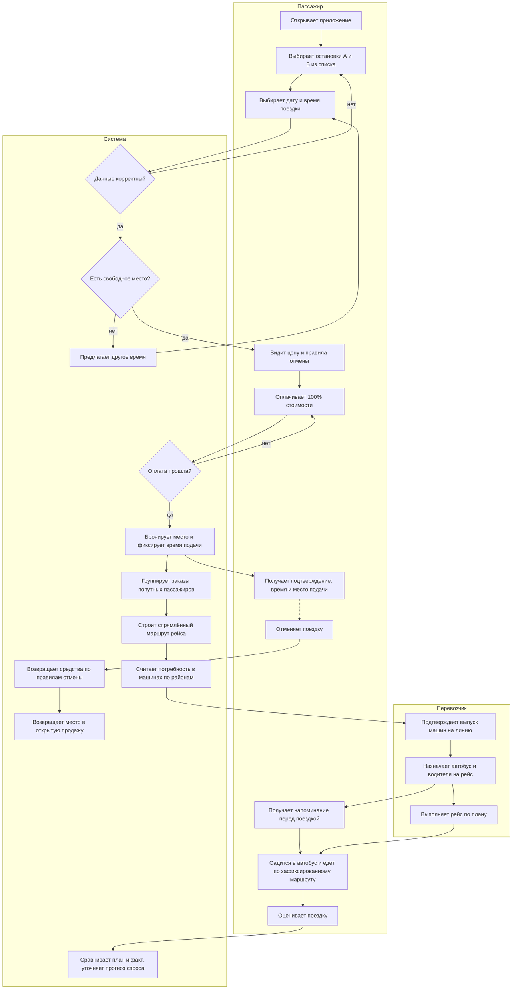

# TO-BE: процесс предзаказа поездки в сервисе «По пути»

Целевой процесс: пассажир заказывает поездку заранее, платит вперёд и получает гарантированное время подачи, а перевозчик заранее знает, сколько машин выпускать на линию.

## Что меняется по сравнению с AS-IS

| Сейчас (AS-IS) | Станет (TO-BE) |
|---|---|
| Заказ «здесь и сейчас», автобус подбирается на ходу | Заказ заранее, за 7–9 часов до поездки |
| Ожидание плавает от 5 до 45 минут | Гарантированное время подачи |
| Автобус сворачивает за попутчиками, время в пути растёт | Маршрут группируется и спрямляется заранее |
| Остановка выбирается автоматически, точка может оказаться «на заборе» | Остановка выбирается из списка |
| Предоплаты и правил отмены нет, автобус ходит полупустым | 100% предоплата, ступенчатый возврат, предсказуемая загрузка |
| Перевозчик не знает спрос заранее | Потребность в машинах считается до начала пика |

## Правила отмены (из итогов встречи)

- мгновенная отмена: возврат 100%;
- более чем за 2 часа до поездки: возврат 50%;
- менее чем за 30 минут: возврат 0%, место возвращается в открытую продажу.
