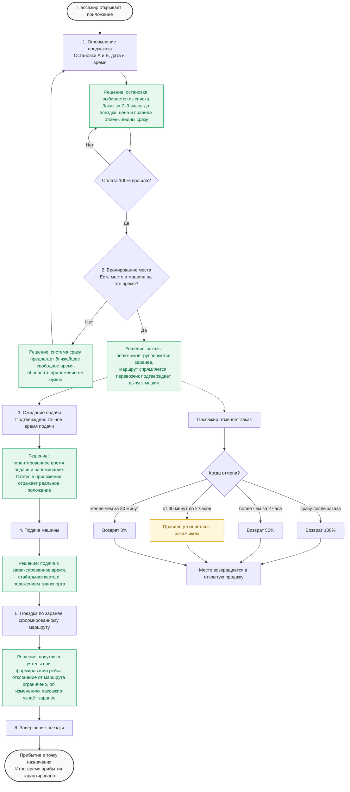

# TO-BE: целевое состояние сервиса заказных перевозок «По пути» с предзаказом

Целевой процесс построен по структуре AS-IS: те же шаги 1–6, но каждая проблема текущего состояния получает решение. Параметры предзаказа (окно 7–9 часов, цена, правила отмены) взяты из итогов встречи с заказчиком.

## Целевой процесс поездки

1. **Оформление предзаказа.** Пассажир выбирает остановки отправления и прибытия из списка, указывает дату и время поездки (оптимально за 7–9 часов до неё: вечером на утро и утром на вечер). Сразу видны стоимость и правила отмены. Заказ подтверждается 100% предоплатой.
2. **Бронирование и формирование рейса.** Система проверяет, есть ли место и машина на выбранное время. Если нет, предлагает ближайшее свободное время. Заказы попутчиков группируются заранее, маршрут спрямляется (магистральные улицы отдельно от подвозных заездов в глубину районов). Перевозчик получает заранее рассчитанную потребность и подтверждает выпуск машин на линию.
3. **Ожидание подачи.** Пассажир знает точное время подачи и получает напоминание. Ожидания «от 5 до 45 минут» больше нет.
4. **Подача машины.** Автобус приходит на выбранную остановку в зафиксированное время, положение транспорта на карте отображается стабильно.
5. **Поездка.** Автобус едет по маршруту, сформированному заранее. Попутные пассажиры уже учтены в рейсе, поэтому резких отклонений ради одного человека нет. Если изменения всё же необходимы, пассажир узнаёт о них заранее.
6. **Завершение.** Пассажир прибывает в гарантированное время. Фактические данные сравниваются с планом и используются для прогноза спроса.

**Отмена.** До поездки заказ можно отменить: возврат 100% при мгновенной отмене, 50% при отмене более чем за 2 часа, 0% при отмене менее чем за 30 минут. Освободившееся место возвращается в открытую продажу. Правило для отмены в промежутке от 30 минут до 2 часов заказчик не назвал, его нужно уточнить.

## Как закрываются проблемы AS-IS

| Проблема AS-IS | Решение в TO-BE |
|---|---|
| Нет выбора остановки из списка, точка привязывается к дому или забору | Остановка выбирается из явного списка |
| Нет гарантии и прогноза времени, нужно обновлять приложение | Место и время подачи фиксируются при заказе, при нехватке мест сразу предлагается другое время |
| Ожидание 5–45 минут, статус зависает | Гарантированное время подачи и напоминание |
| Нестабильная карта, нужен перезапуск | Требования к стабильному отображению положения транспорта |
| Резкие отклонения от маршрута, время в пути растёт до 2 раз | Рейс формируется заранее, отклонение ограничено, изменения сообщаются заранее |
| Транспорт ходит полупустым (1–2 пассажира) | Предоплата и группировка заказов дают прогнозируемую загрузку |
| Перевозчик не знает спрос и не может планировать выпуск машин | Потребность в машинах считается до начала пика |
| Постоянные пассажиры уезжают на такси | Предзаказ даёт предсказуемость по цене (150–200 ₽ против ~1000 ₽ за такси) и по времени |

## Что получают стороны

### Пассажир

- Гарантированное время подачи и место в салоне.
- Прозрачная цена и правила отмены и возврата.
- Возможность спланировать поездку к точному времени (смена, метро, проходная).

### Перевозчик (Мосгортранс / Дептранс)

- Гарантированный объём пассажиропотока за счёт предоплаты.
- Суточная потребность территорий в предзаказах и оптимальный выпуск машин на линию.
- Меньше холостых пробегов за счёт спрямлённых маршрутов.
- Финансовая модель с предоплатой, тарификацией и покрытием простоев.

## Что нужно проверить

Целевой процесс опирается на гипотезы, которые пока не подтверждены (см. «Таблицу предположений» и «Что может помешать гипотезе сработать»):

- пассажиры готовы планировать поездку за 7–9 часов и платить 150–200 ₽;
- машин в часы пик хватит на предзаказы;
- перевозчик и Дептранс поддержат запуск;
- предзаказ действительно делает время в пути предсказуемым.

## Ограничения

- Внутренняя аналитика недоступна, параметры (окно заказа, цена, доли возврата) получены как оценки заказчика и требуют проверки.
- Правила для сочетания предзаказов и поездок «здесь и сейчас» (какую долю машин резервировать) пока не определены.
- Целевой процесс описывает логику сервиса, а не техническую реализацию.

## Резюме

В TO-BE сервис переходит от модели «здесь и сейчас» к предзаказу: пассажир получает гарантированное время и место, перевозчик получает прогнозируемый спрос и стабильную загрузку. Каждая проблема AS-IS (остановки, ожидание, карта, отклонения от маршрута, неопределённость спроса) получает конкретное решение, а успех зависит от проверки гипотез о готовности пассажиров планировать заранее и платить больше.
