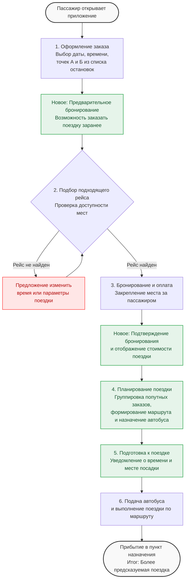

# Диаграмма to-be

---

#### Целевой процесс поездки
1. Оформление заказа. Пассажир выбирает дату, время, остановки и количество мест.
2. Проверка доступности. Система проверяет наличие подходящего рейса и свободных мест. При отсутствии вариантов предлагает изменить параметры.
3. Бронирование и оплата. Пассажир выбирает рейс, бронирует места и оплачивает поездку.
4. Планирование перевозок. Система собирает предварительные заявки, объединяет совместимые заказы, формирует маршруты и назначает транспорт.
5. Подготовка к поездке. Пассажир получает подтверждение и информацию о времени и месте посадки.
6. Выполнение поездки. Автобус прибывает к остановке и следует по заранее сформированному маршруту.
    
---
### Ожидаемые изменения после внедрения решения

#### Для пассажира

- Предсказуемость поездки. Возможность заранее выбрать время отправления и получить информацию о предполагаемом времени прибытия.
- Понятная точка посадки. Выбор остановки из списка вместо автоматического определения произвольной точки.
- Гарантия забронированного места. После подтверждения бронирования место резервируется за пассажиром.
- Контролируемое время в пути. Попутные заказы учитываются при формировании маршрута, что позволяет ограничить существенные отклонения.
- Прозрачность условий поездки. Пользователь заранее видит основные параметры рейса и стоимость.
    
---
#### Для перевозчика

- Прогнозируемый спрос. Предварительные заявки позволяют оценивать количество пассажиров на определённые временные интервалы.
- Повышение загрузки транспорта. Объединение совместимых заказов позволяет эффективнее использовать свободные места.
- Планирование выпуска транспорта. Возможность заранее распределять автобусы между сформированными рейсами.
- Снижение незапланированных отклонений. Маршруты формируются с учётом нескольких заказов до начала поездки.
- Аналитика перевозок. Возможность анализировать спрос, загрузку, отмены и выполнение рейсов.
    
---
#### Ограничения целевого решения

- Качество планирования зависит от полноты и актуальности данных об остановках, маршрутах и доступном транспорте.
- Фактическое время поездки может отличаться от расчётного из-за пробок, погодных условий и других внешних факторов.
- Эффективность группировки заказов зависит от количества заявок, их географического расположения и временных интервалов.
- Для полноценной работы системы необходимы актуальные сведения о транспортных средствах и их вместимости.
- Предлагаемый процесс является целевой моделью; его отдельные этапы требуют дополнительной реализации и проверки на реальных данных.
    
---
#### Резюме

В целевом состоянии сервис переходит от модели поездок «здесь и сейчас» к модели предварительного планирования перевозок. Пассажир получает возможность заранее выбрать поездку, забронировать место и узнать основные параметры рейса. Перевозчик получает предварительные данные о спросе, что позволяет объединять совместимые заказы, формировать маршруты и планировать использование транспорта.

Таким образом, предлагаемое решение направлено на повышение предсказуемости поездок для пассажиров и эффективности использования транспортных средств для перевозчика.
