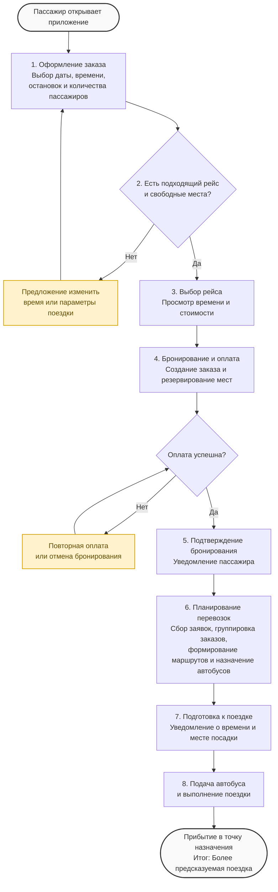

# Диаграмма to-be

---
#### Целевой процесс поездки

1. Выбор параметров поездки. Пассажир указывает дату, время и количество пассажиров. Предусматривается возможность предварительного бронирования за несколько часов или дней до поездки.
2. Выбор остановок. Пассажир выбирает точку посадки и назначения из доступного списка остановок, что позволяет избежать некорректного определения местоположения.
3. Проверка возможности поездки. Система проверяет наличие подходящих рейсов и свободных мест. Если подходящего варианта нет, пассажиру предлагается изменить время или параметры поездки.
4. Выбор рейса. Пользователь получает список доступных вариантов с информацией о времени отправления, предполагаемом прибытии, стоимости и наличии свободных мест.
5. Предварительное бронирование. После выбора рейса система создаёт заказ и резервирует необходимое количество мест.
6. Оплата. Пассажир оплачивает поездку. При возникновении ошибки ему предоставляется возможность повторить попытку или отменить бронирование.
7. Подтверждение поездки. После успешной оплаты пользователь получает подтверждение бронирования.
8. Обработка предварительных заказов. Система собирает заявки на определённые временные интервалы и анализирует их для дальнейшего планирования перевозок.
9. Группировка попутных заказов. Алгоритм объединяет совместимые заявки с учётом времени поездки, расположения остановок, вместимости транспорта и допустимого отклонения от маршрута.
10. Планирование рейсов. На основе сгруппированных заказов формируются рейсы и распределяются доступные транспортные средства.
11. Информирование пассажира. Пользователь получает информацию о подтверждённой поездке и напоминание перед отправлением.
12. Подача автобуса. Транспорт прибывает к согласованной точке посадки в запланированное время. Пассажир получает информацию о месте посадки.
13. Выполнение поездки. Автобус следует по заранее сформированному маршруту. Попутные заказы учитываются на этапе планирования, что позволяет ограничить незапланированные отклонения.
    
---
### Ожидаемые изменения после внедрения решения

#### Для пассажира

- Предсказуемость поездки. Возможность заранее выбрать время отправления и получить информацию о предполагаемом времени прибытия.
    
- Понятная точка посадки. Выбор остановки из списка вместо автоматического определения произвольной точки.
    
- Гарантия забронированного места. После подтверждения бронирования место резервируется за пассажиром.
    
- Контролируемое время в пути. Попутные заказы учитываются при формировании маршрута, что позволяет ограничить существенные отклонения.
    
- Прозрачность условий поездки. Пользователь заранее видит основные параметры рейса и стоимость.
    
---
#### Для перевозчика

- Прогнозируемый спрос. Предварительные заявки позволяют оценивать количество пассажиров на определённые временные интервалы.
    
- Повышение загрузки транспорта. Объединение совместимых заказов позволяет эффективнее использовать свободные места.
    
- Планирование выпуска транспорта. Возможность заранее распределять автобусы между сформированными рейсами.
    
- Снижение незапланированных отклонений. Маршруты формируются с учётом нескольких заказов до начала поездки.
    
- Аналитика перевозок. Возможность анализировать спрос, загрузку, отмены и выполнение рейсов.
    
---
#### Ограничения целевого решения

- Качество планирования зависит от полноты и актуальности данных об остановках, маршрутах и доступном транспорте.
    
- Фактическое время поездки может отличаться от расчётного из-за пробок, погодных условий и других внешних факторов.
    
- Эффективность группировки заказов зависит от количества заявок, их географического расположения и временных интервалов.
    
- Для полноценной работы системы необходимы актуальные сведения о транспортных средствах и их вместимости.
    
- Предлагаемый процесс является целевой моделью; его отдельные этапы требуют дополнительной реализации и проверки на реальных данных.
    
---
#### Резюме

В целевом состоянии сервис переходит от модели поездок «здесь и сейчас» к модели предварительного планирования перевозок. Пассажир получает возможность заранее выбрать поездку, забронировать место и узнать основные параметры рейса. Перевозчик получает предварительные данные о спросе, что позволяет объединять совместимые заказы, формировать маршруты и планировать использование транспорта.

Таким образом, предлагаемое решение направлено на повышение предсказуемости поездок для пассажиров и эффективности использования транспортных средств для перевозчика.
